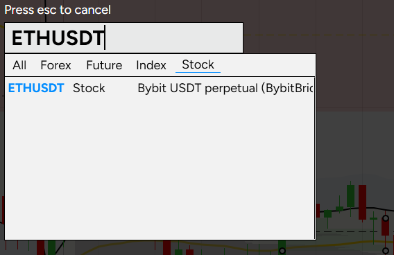
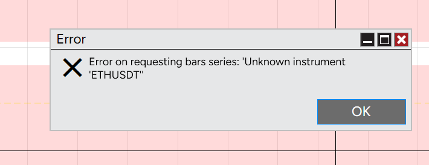

# Bybit data feed for NinjaTrader 8

Brings **Bybit USDT perpetuals** into NinjaTrader 8 as charting data: historical candles plus live ticks, for ~820 instruments, using NinjaTrader's built-in **External** connection.

NinjaTrader 8 has no Bybit connection of its own and no public way to add a custom one. This project is the workaround that worked for me: a small bridge pushes live ticks through NinjaTrader's Automated Trading Interface (ATI), and an AddOn fills NinjaTrader's own database with Bybit history.

> **Status: hobby project, shared as is.** No warranty, no support obligation, not financial advice. See [Disclaimer](#disclaimer) and [Limitations](#limitations) before you use it.

---

## What you get

- Charts for all Bybit USDT perpetuals in NinjaTrader (1 minute and up, daily/weekly/4H aligned with Bybit/TradingView).
- Live ticks (trades + best bid/ask) for the coins you list in `symbols.txt`.
- Automatic history for *all* coins, refreshed hourly, including new listings and delistings.
- Gap filling after downtime (e.g. when NinjaTrader was closed).
- Per-PC settings, hot-reload of the live-coin list (no restart needed).

It is **market data only**. There is no order routing; you cannot trade on Bybit from NinjaTrader with this.

## How it works

| Component | What it does |
|---|---|
| `BybitBridge.exe` (built from `BybitBridge.cs`) | Listens to Bybit's public WebSocket (trades + top of book) and sends the ticks to NinjaTrader through the ATI (port 36973). Only for the coins in `symbols.txt` (the "live layer"). |
| `BybitHistoryAddOn.cs` (NinjaScript AddOn) | Creates the instruments (type Stock, 24x7, correct tick size) and writes Bybit candles (1 minute + daily) into NinjaTrader's database. Live layer: refreshed every 5 min. History layer: all ~820 USDT perpetuals, refreshed hourly; the list of coins (listings/delistings) is fetched hourly too. |

NinjaTrader builds higher timeframes (5m, 15m, 1h, ...) from the minute data itself. Volumes are expressed in *lots* (Bybit's smallest tradable unit = 1), because the ATI only accepts whole numbers.

## Requirements

- Windows with **NinjaTrader 8** (developed on 8.1.8.4), started at least once.
- A NinjaTrader license that allows the **Automated Trading Interface (ATI)** - check your license type on NinjaTrader's site; I cannot tell you which licenses include it.
- PowerShell 5.1 (included with Windows) and the .NET Framework 4.x compiler that ships with Windows (`csc.exe`). No SDK needed.
- Internet access to `api.bybit.com` and `stream.bybit.com`. No Bybit account or API key is needed (public market data only).

## Installation

1. **Back up your NinjaTrader 8 folder** (`Documents\NinjaTrader 8`). The AddOn writes directly into NinjaTrader's database, which is not an officially supported way of adding data.
2. Unzip this folder somewhere permanent (e.g. `C:\Tools\BybitNinjaTraderFeed`).
3. Run **`setup.ps1`**. Open PowerShell in the unzipped folder (in File Explorer type `powershell` in the address bar and press Enter) and run:

   ```
   powershell -ExecutionPolicy Bypass -File .\setup.ps1
   ```

   Running it this way keeps the window open so you can read any message, and avoids Windows blocking scripts that came from a downloaded ZIP ("running scripts is disabled" / "not digitally signed"). The script:
   - creates `machines\<computername>\` with your settings (from the templates),
   - builds `BybitBridge.exe` (`build_bridge.ps1`; it copies `NinjaTrader.Client.dll` from *your own* NinjaTrader installation - that file is NinjaTrader's property and is not part of this repository),
   - sets the user environment variable `BYBIT_FEED_DIR` so the AddOn finds this folder,
   - copies the AddOn and the trading-hours template into your NinjaTrader folder,
   - creates desktop shortcuts, and tests that Bybit is reachable.
4. In NinjaTrader (once):
   1. **Restart NinjaTrader** (it reads trading-hours templates and environment variables only at startup).
   2. *Tools > Settings > Automated trading interface*: switch ATI **on** (port 36973), restart NinjaTrader if asked.
   3. *Tools > Connections*: add **External** and connect it.
   4. Make sure the AddOn compiled (NinjaScript Editor > F5; no errors).
5. Start the shortcut **Bybit Bridge (NinjaTrader)**, then open charts (e.g. `BTCUSDT`).
6. The first fill of all coins takes 2 to 3 hours in the background; progress is logged to `machines\<computername>\addon.log`.

> **Close or disable your trading strategies before NinjaTrader compiles NinjaScript** - compiling reloads everything.

## Daily use

The External connection is exclusive: while it is connected, no other connection (e.g. your futures broker) can be active at the same time. That is a NinjaTrader limitation. A typical routine:

**Crypto session**
1. NinjaTrader: disconnect your other connection, connect **External**.
2. Start the bridge shortcut. With `followBridge=true` (default) the AddOn is active exactly while the bridge runs.

**Back to your other connection**
1. Close the bridge window (the AddOn pauses by itself, also in the middle of a cycle).
2. NinjaTrader: disconnect External, connect your other connection.

The **Bybit AddOn ON / OFF** shortcuts are a master switch per PC (OFF = never write, even when the bridge runs). They only rename `machines\<pc>\addon_enabled.txt` to `addon_enabled.txt.off` and back; NinjaTrader needs no restart or recompile for that.

## What you will see in NinjaTrader

**Instruments.** The coins show up as **Stock** instruments in NinjaTrader's instrument search (the *Stock* tab), named exactly like Bybit's symbols (`BTCUSDT`, `ETHUSDT`, `1000PEPEUSDT`, ...) with the description *Bybit USDT perpetual (BybitBridge)*. They are 24x7, have Bybit's tick size, and a point value of 1. Type the Bybit symbol in the search box and pick the one with that description.



**The "Unknown instrument" error popup.** Whenever a chart requests its history, NinjaTrader asks the External connection for it, and External cannot deliver history. NinjaTrader then shows this popup:



*Error on requesting bars series: 'Unknown instrument 'ETHUSDT''*

**It is harmless: click OK.** The chart still shows all the data, because the AddOn has already written the history into NinjaTrader's database. You typically see it when you open a chart, switch timeframe for the first time, or reload the chart data (Ctrl+Shift+R). It cannot be suppressed from the outside; keep NinjaTrader's *Get data from server* option on, as it is by default.

## Live coins

Edit `machines\<computername>\symbols.txt`, one coin per line (`#` = comment):

```
# a comment line (comments must start at the beginning of a line)
BTCUSDT
ETHUSDT
1000PEPEUSDT
```

Optionally a line can be `BYBITSYMBOL,NT_INSTRUMENT_NAME` to give the instrument a different name in NinjaTrader. Comments are only recognised at the start of a line, not after a symbol.

The bridge re-reads this file every 5 seconds: add or remove coins without restarting. The AddOn picks up new live coins within 5 minutes. Use Bybit's names (e.g. `1000PEPEUSDT`), not other exchanges' names.

Putting *all* coins in the live list is possible but loads NinjaTrader heavily (every tick is an ATI call) and can cause lag; I deliberately keep it limited.

## AddOn settings (`machines\<computername>\addon_enabled.txt`)

`key=value`, re-read every cycle. The existence of the file means "active"; removing or renaming it pauses the AddOn.

| Key | Default | Meaning |
|---|---|---|
| `minuteDays` | 30 | Days of minute data on the first fill of a **live** coin |
| `minuteDaysAll` | 14 | Same for all other coins (history layer) |
| `dailyDays` | 400 | Daily candles on the first fill |
| `refreshMinutes` | 5 | Refresh interval, live coins |
| `refreshMinutesAll` | 60 | Refresh interval, other coins |
| `refreshWindowMinutes` | 120 | Minimum look-back window when topping up |
| `universe` | `all` | `all` = every Bybit USDT perpetual (history layer); `live` = only the bridge's coins |
| `universeLimit` | 0 | 0 = all; N = only the first N coins (careful test) |
| `budgetSeconds` | 240 | Maximum working time per cycle for the history layer |
| `symbols` | (empty) | Optional filter, `A,B,C` |
| `followBridge` | `true` | AddOn only works while `BybitBridge.exe` runs |
| `dailyLabelOffset` | 0 | Time label of daily candles: 0 = date of the UTC day, 1 = date of the next day. Only change this if daily candles look shifted by one day compared to TradingView; the AddOn then rewrites all daily candles |
| `cleanupDescription` | (empty) | Advanced: description text of instruments that may be cleaned up (e.g. old instruments from a previous connector) |
| `cleanupConfirm` | `false` | `false` = only list candidates in the log; `true` = actually delete them |

## Daily candles and trading hours (UTC)

- Instruments get the trading-hours template **"Bybit 24 x 7 UTC"** (`Bybit 24 x 7 UTC.xml`; `setup.ps1` copies it to NinjaTrader's `templates\TradingHours`). Daily, weekly and 4H candles then line up with Bybit/TradingView; 1 minute to 1 hour are unaffected. Until the template exists the AddOn falls back to "Default 24 x 7".
- Daily candles are written as UTC days **including the running day**, refreshed on every top-up. With the bridge running, the last candle then moves with live ticks. Coins that are not live can lag by up to an hour.

## Folder layout

- `symbols.txt`, `addon_enabled.txt` in the root are **templates**; the real settings live per PC in `machines\<computername>\` (so a synced/shared folder never mixes up state between PCs).
- `machines\<pc>\state\` holds per-coin markers ("filled on", "last topped up"). Do not delete them unless you want a coin re-filled (delete `init_<COIN>.txt` to re-fill one coin).
- `machines\<pc>\addon.log`, `instruments.csv`, `state.csv`: log and status files.

## Limitations

- **Only one External connection at a time**, and it excludes other NinjaTrader connections while connected.
- **No order routing / no Bybit trading** - charting data only.
- **Volumes are in lots**, not coin units (ATI limitation).
- **Not an officially supported way** to feed NinjaTrader: the AddOn writes NinjaTrader's database files directly. NinjaTrader updates may break it. Keep backups.
- NinjaTrader's `Bars.Save()` replaces the whole day/year file it touches; the AddOn therefore always writes whole days/years. Do not change this without understanding it.
- A coin you put on the live list first gets a default stock instrument created by NinjaTrader itself (wrong hours/tick); the AddOn repairs this in its next cycle and refills the coin.
- The message *"Error on requesting bars series: Unknown instrument"* when opening or switching charts is harmless (External cannot deliver history; the data is in NinjaTrader's database).
- The database grows by roughly 150 to 200 MB and is partly rewritten on every top-up. If your NinjaTrader folder is cloud-synced (OneDrive etc.), consider excluding it from sync on PCs where NinjaTrader does not run.

## Troubleshooting

| Symptom | Cause / fix |
|---|---|
| AddOn does nothing | No `addon_enabled.txt` in `machines\<pc>\`, or the project folder was not found (the NinjaTrader log says so; set the environment variable `BYBIT_FEED_DIR` and restart NinjaTrader), or `followBridge=true` and the bridge is not running. |
| Bridge says it is waiting for NinjaTrader | ATI is off or NinjaTrader is not running. The bridge waits and resumes by itself. |
| Chart is empty on first open (daily) | Normal for a new coin until the AddOn has finished; check with a 1-minute chart. |
| Wrong tick size / trading hours on an instrument | The AddOn repairs this automatically in its next cycle. |
| Daily candles look one day off versus TradingView | Set `dailyLabelOffset=1` in `addon_enabled.txt`. |
| `setup.ps1` cannot find NinjaTrader's bin folder | Run `build_bridge.ps1 -NtBin "<path to NinjaTrader 8\bin>"` and `setup.ps1 -NtFolder "<path to Documents\NinjaTrader 8>"`. |

## Disclaimer

This is an independent hobby project. It is **not affiliated with, endorsed by or supported by Bybit or NinjaTrader**; both names are trademarks of their respective owners. It uses only public Bybit market data. It is provided under the MIT License, **"as is", without warranty of any kind**. It modifies NinjaTrader's database: **make a backup first and use it at your own risk**. Nothing here is financial advice, and data may be delayed, incomplete or wrong - do not rely on it for trading decisions without verifying it yourself.

## Support the project

This is free software and will stay free. I cannot promise support or response times; issues and pull requests are welcome on a best-effort basis. If it saves you time and you would like to say thanks, a voluntary donation is appreciated but never expected:

**[ko-fi.com/borstworks](https://ko-fi.com/borstworks)**

A donation does not buy support, features or any kind of service.

## License

MIT - see [LICENSE](LICENSE).
